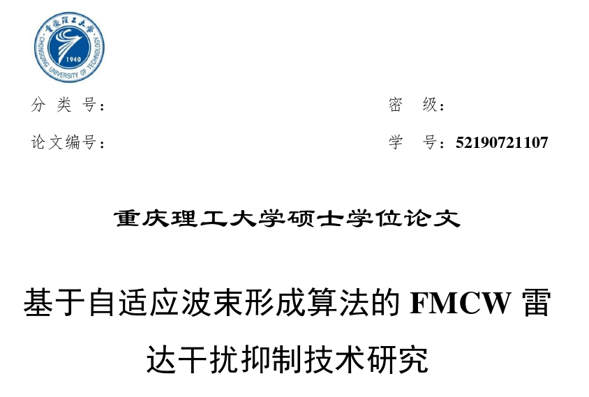
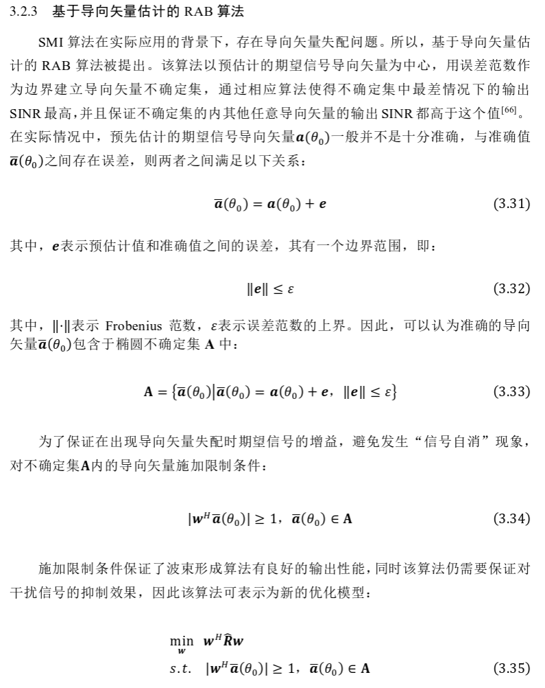
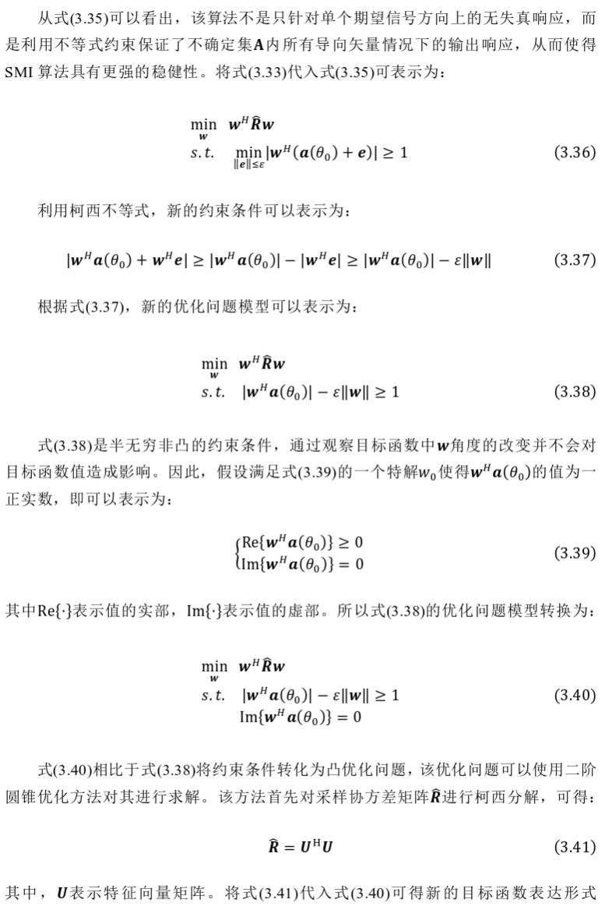
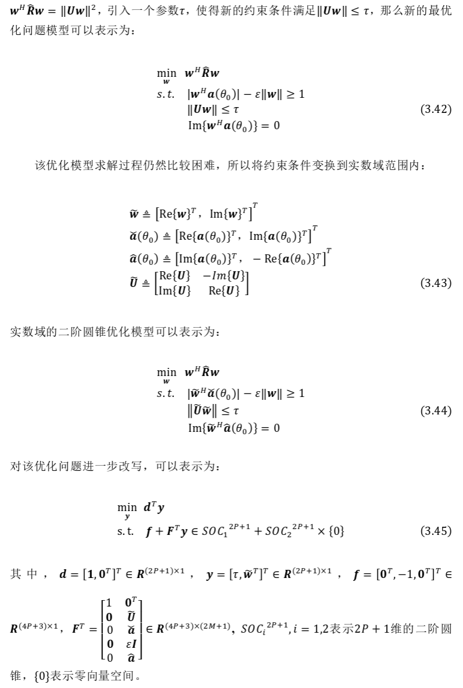
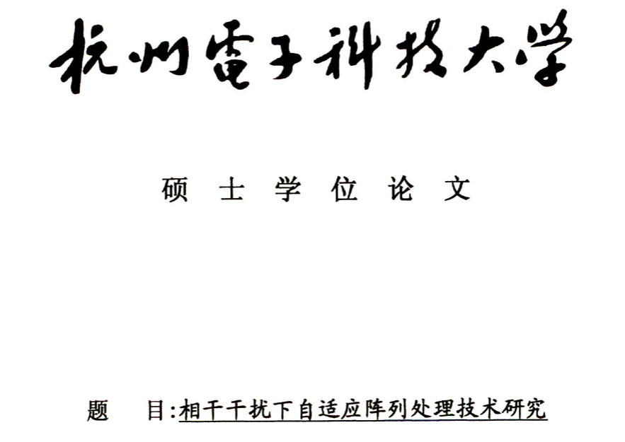
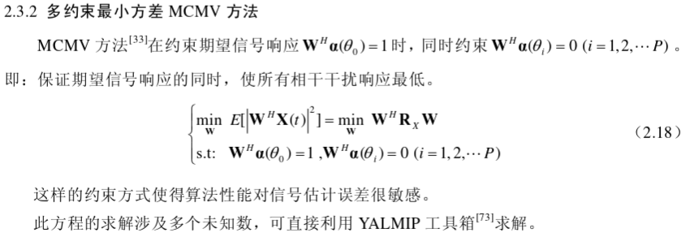
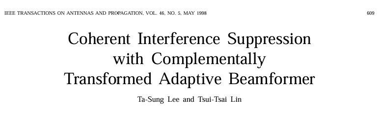
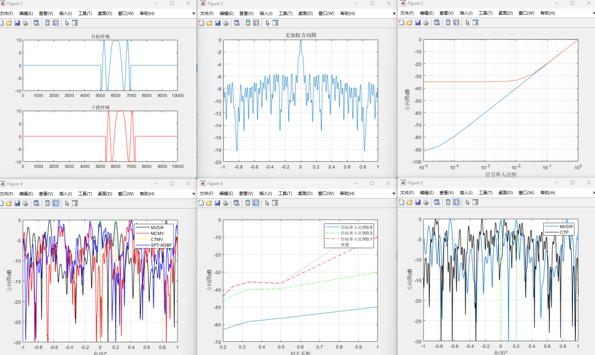

# Interference Reduction in Radar Airspace Coherent Interference Reduction Method [with MATLAB Code]

SMI Algorithm
The formula (3.45) represents the final model converted to a second-order cone optimization problem. Although this method can be solved using convex second-order cone optimization methods, the computational complexity remains relatively high after implementing response operations on the uncertain set. On the other hand, determining the upper bound of the optimal error norm in equation (3.33) lacks precise optimization criteria. If the value of 𝜀 is too small, the elliptical uncertain set may not contain the accurate desired signal steering vector, which cannot ensure the robustness of the adaptive algorithm; if 𝜀 is too large, the range of uncertainty set selection could be excessively large, leading to significant errors and degrading the output performance of the adaptive beamforming algorithm. Therefore, accurately obtaining the optimal error norm upper bound and reducing the algorithm's computational load remain challenges for this class of algorithms.
MCMV Algorithm
CTMV Algorithm
MATLAB Simulation Results

## Images

<!-- PAYMENT_BLOCK -->

## Get this dataset

- Payment link (Stripe): [Buy now](https://buy.stripe.com/3cs8yP7sY87d0vu9AB)
- Payment QR code: 

<!-- /PAYMENT_BLOCK -->
